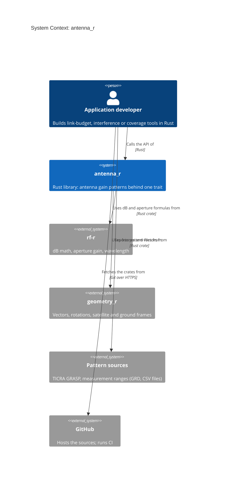

# C4 level 1: System context

`antenna_r` is a library linked into the developer's program. It has no runtime connections to
other systems; pattern files reach it as text read by the caller.

Elements:
- **Application developer**: anyone building antenna or RF tooling in Rust.
- **antenna_r**: this crate.
- **rf-r**, **geometry_r**: sibling crates, git dependencies.
- **Pattern sources**: produce the GRD and CSV files the developer passes to the parsers.
- **GitHub**: source hosting and CI, build time only.
